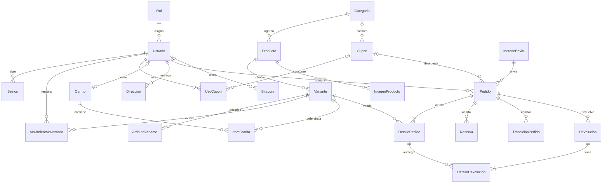

# ShopCart

## Requisitos

Hace falta Node 24, pnpm 11.6, SQL Server 2022 Express y Redis 8. Con Docker esos cuatro vienen en los contenedores y solo hace falta Docker. Sin Docker hay que tenerlos instalados en la máquina.

Hay que configurar las variables de entorno. Son tres grupos: las de SQL, las de Redis y las de inicio. `.env.example` trae un ejemplo para Docker. Se copia a `.env` y ahí van los valores que se quieran usar. Los del ejemplo son de demostración.

```env
# SQL

# obligatorio. Host de SQL. En Docker es el contenedor; si es remoto, ese host
SQL_SERVIDOR=sqlserver

# opcional. Puerto de SQL Server. Por defecto 1433
SQL_PUERTO=1433

# obligatorio. Nombre de la base
SQL_BASE=ShopCart

# obligatorio. Login con el que la API ejecuta los procedures
SQL_USUARIO_APP=shopcart_app

# obligatorio. Contraseña de ese login
SQL_CONTRASENA_APP=Datos_Demo_2026!

# obligatorio con Docker y sqlcmd. Contraseña de sa. La API no la usa
SQL_CONTRASENA_SA=Express_Demo_2026!

# Redis

# obligatorio. Dirección de Redis. Si es remoto, ese host
REDIS_URL=redis://redis:6379

# Inicio

# obligatorio. Correo del administrador
USUARIO_ADMINISTRADOR_CORREO=admin@shopcart.demo

# obligatorio. Contraseña del administrador
USUARIO_ADMINISTRADOR_CONTRASENA=Admin_Demo_2026!

# obligatorio. Correo del operador
USUARIO_OPERADOR_CORREO=operador@shopcart.demo

# obligatorio. Contraseña del operador
USUARIO_OPERADOR_CONTRASENA=Operador_Demo_2026!

# obligatorio. Correo del cliente
USUARIO_CLIENTE_CORREO=cliente@shopcart.demo

# obligatorio. Contraseña del cliente
USUARIO_CLIENTE_CONTRASENA=Cliente_Demo_2026!
```

Con `docker compose up` el SQL remoto no se usa. El servicio `api` deja `SQL_SERVIDOR` en `sqlserver` y lo que esté en `.env` no llega a la API. `sql-inicial` aplica los scripts ahí, no en el SQL remoto. Si el SQL es remoto, la API se levanta sin ese contenedor, se apunta el host en `.env` y ese servidor ya tiene que tener la base, el login `shopcart_app` y los scripts del `001` al `010`. Si el host no responde o el login no existe, el proceso termina.

El resto del ejemplo también va en ese archivo: `PUERTO_API` (opcional, por defecto 3000), secretos JWT, bcrypt, `INTENTOS_MAXIMOS` del login, `LIMITE_RUTA` del resto de endpoints, minutos de reserva y de carrito abandonado, y `SEMILLA_DATOS` (`1` aplica la semilla de rendimiento, `0` la omite). Los dos secretos JWT son obligatorios, distintos y de al menos 32 caracteres.

Comprueba el arranque:

- `GET http://localhost:3000/health`
- `GET http://localhost:3000/docs`
- `GET http://localhost:3000/openapi.json`

## Con Docker

En la raíz del repositorio:

```bash
cp .env.example .env
docker compose up --build
```

El contenedor `sql-inicial` aplica `base-de-datos/scripts` en orden, del `001` al `010`, una sola vez. Si `SEMILLA_DATOS=1`, también aplica `011_semilla.sql` (catálogo, existencias, cupones, pedidos pagados y carritos abandonados para listados y reportes). Con `SEMILLA_DATOS=0` omite esa semilla. La API espera a que ese paso termine y a que Redis responda.

Los scripts no son idempotentes. Si el volumen de SQL ya existía y cambiaste un script, hay que recrearlo:

```bash
docker compose down -v
docker compose up --build
```

## Sin Docker

Las de SQL y Redis del ejemplo apuntan a los contenedores. En la máquina local se cambian estas dos. Si el SQL es remoto, `SQL_SERVIDOR` lleva ese host y `sqlcmd -S` apunta al mismo.

```
SQL_SERVIDOR=localhost
REDIS_URL=redis://127.0.0.1:6379
```

SQL Server Express tiene que estar en el puerto 1433 y Redis en el 6379. Los scripts se aplican en orden, del `001` al `010`, con `sqlcmd`. El `011_semilla.sql` solo si quieres datos de prueba. `-I` deja `QUOTED_IDENTIFIER` encendido, que hace falta para los índices filtrados. `ContrasenaApp` es la contraseña de `SQL_CONTRASENA_APP` y crea el login `shopcart_app`.

```bash
sqlcmd -C -I -f 65001 -S localhost -U sa -b -v ContrasenaApp=Datos_Demo_2026! -i base-de-datos/scripts/001_crear_base.sql
```

El resto igual, del `002` al `010`. Si un script ya se aplicó, el `CREATE TABLE` falla: la base tiene que estar vacía.

En la raíz, con pnpm:

```bash
corepack enable
pnpm install --frozen-lockfile --filter shopcart-api
pnpm --dir backend dev
```

`dev` recarga al guardar. Para dejarlo compilado: `pnpm --dir backend build` y después `pnpm --dir backend start`.

## Credenciales de prueba

Al arrancar, la API crea estos tres usuarios si el correo todavía no existe. No actualiza la contraseña si el correo ya está.

| Rol | Correo | Contraseña |
| --- | --- | --- |
| Administrador | admin@shopcart.demo | Admin_Demo_2026! |
| Operador | operador@shopcart.demo | Operador_Demo_2026! |
| Cliente | cliente@shopcart.demo | Cliente_Demo_2026! |

Esos correos y contraseñas están en `.env.example`. Son los del demo y se pueden cambiar: copia ese archivo a `.env` y pon los que quieras. Lo mismo con los secretos de firma y la contraseña de SQL. Los dos secretos JWT tienen que ser distintos y de al menos 32 caracteres.

Entra con `POST /autenticacion/entrar`. El access token dura 15 minutos y el refresh siete días. No pegues un JWT en el repositorio: pídelo en esa ruta y pégalo en Authorize, en `/docs`.

## Probar con Postman

1. Importa `postman/ShopCart.postman_collection.json`.
2. Importa `postman/local.example.json` como entorno y selecciónalo.
3. En el entorno, pon el correo y la contraseña de la tabla de arriba.
4. Ejecuta **Entrar**. La request guarda `accessToken` y `refresco`. El entorno de ejemplo los deja vacíos a propósito.

`{{baseUrl}}` apunta a `http://localhost:3000`. La colección recorre autenticación, catálogo, inventario, cupones, carrito, pago, pedidos, reportes y bitácora.

## Diagrama entidad-relación



## Decisiones

- Aunque no se pidió, se agregó Redis, ya que era necesario para los siguientes puntos:
  - Guardar lo que más se pide: el catálogo (`catalogo`), los envíos (`envios`) y los reportes (`reportes`).
  - Mientras el dato siga en caché, esa lectura no toca la base y, con mucha concurrencia, la base no se estresa.
  - La existencia y el precio congelado no viven ahí.
  - Cuando esos datos cambian se borra la clave con un solo `DEL` y la siguiente lectura vuelve a SQL.
  - Si Redis cae, se lee SQL.
  - Contar los intentos de entrada y de cupón. Tras el tope se responde 429.
  - Anular el access token al salir, hasta que venza.
  - Guardar el candado del pago, para que dos cobros de la misma variante no se pisen.
  - La cola que suelta las reservas cuando se cumplen los 15 minutos.

- La contraseña se guarda con bcrypt de costo 12 y una sal distinta dentro de cada hash. Esto para que, al momento de un robo de usuarios, los atacantes no puedan saber las claves, ya que cada una queda en un hash distinto.
- El login compara siempre, aunque el correo no exista. Usa un hash ficticio, espera entre 50 y 150 ms y responde el mismo mensaje. Esto para que un atacante no sepa si esa cuenta está libre solo por el tiempo o por la respuesta. El registro sí puede decir que el correo existe. Tras varios intentos, Redis responde 429.
- El access y el refresh usan secretos distintos y el algoritmo queda fijado en HS256. El refresh se guarda solo como hash. Esto para que, si roban la base, no se lleven un token que todavía sirva. Hay una sesión activa por usuario. Si alguien reusa el refresh fuera de la gracia de 10 segundos, se revoca la sesión. Salir anula el access token en Redis hasta que venza, así un token robado deja de servir en cuanto el usuario sale.
- CORS sale de `ORIGENES_PERMITIDOS`. El cuerpo JSON tiene tope de 32 KB. `trust proxy` está apagado. Esto para que un sitio ajeno no llame la API y para que un error del motor no muestre el SQL. Un error de negocio responde `codigo` y `mensaje` en español.
- Se integró Swagger y Postman para poder facilitar las pruebas y la documentación. En `/docs` está cada ruta y en Postman la colección con los ejemplos, así el cuerpo y la respuesta ya están escritos.
- Cada operación tiene su DTO y rechaza los campos que no le pertenecen. El registro solo acepta correo y contraseña: si el cuerpo trae el rol, se rechaza. Esto para que nadie se cree como administrador. En un endpoint de editar usuario pasaría lo mismo: el DTO no llevaría el rol, así no se cambia un atributo que vulnera la plataforma. Esos valores tampoco se pegan dentro de un texto SQL. Van como parámetros del procedure, así un correo o un nombre con comillas no se vuelve una consulta y no hay inyección.
- `sesion` lee el usuario en la base a partir del token. El rol escrito en el JWT no manda. Sin sesión válida responde 401. Esto para que un token vencido o cerrado no siga entrando.
- `fijarDueno` toma el `IDUsuario` de esa sesión. No se pide el id del usuario en la ruta ni en el cuerpo. Esto para que alguien no mande el id de otro y use su carrito, sus direcciones o su pago. Si la ruta aceptara ese id, sería una vulnerabilidad.
- `exigirRol` compara el rol que salió de la base. Si no alcanza, responde 403. Esto para que un cliente no entre a las rutas de administrador solo por decir que lo es.
- `limitar` cuenta por endpoint, por IP y, si hay sesión, por usuario. El login usa `INTENTOS_MAXIMOS` (5). El resto de rutas usa `LIMITE_RUTA` (60). Tras el tope responde 429. Si Redis no responde, la ruta sigue.
- Se usó Docker para la portabilidad. SQL Server, Redis y la API suben juntos con `docker compose up`. Esto para que no haya problemas con las librerías ni con las versiones de cada máquina: cualquiera lo puede correr y siempre funciona igual.
- Las dependencias se instalan con pnpm y el lockfile congelado. Esto para fijar la cadena de suministro y que no entre un paquete distinto al que quedó revisado. No se usa `exceljs` porque tiene una vulnerabilidad conocida. En su lugar el Excel se arma a mano: es un zip de XML, el formato Open XML, sin una librería de hojas.
- El pago está simulado: el cuerpo de `POST /pago/cobrar` trae `aprobado`. Esto para poder probar el cobro sin una pasarela. Si viene en verdadero, el pedido queda pagado. Si viene en falso, se cancela y se suelta la reserva.
- El envío tiene un costo fijo: retiro en tienda a 0.00, estándar a 25.00 y express a 45.00. Esto para que el total lleve el envío sin consultar a una paquetería.
- La imagen del producto es una URL. Esto para mostrar la foto en el catálogo sin guardar el archivo en el servidor.
- El carrito de invitado usa el encabezado `Carrito-Token`. Para pagar hay que entrar y pasar ese carrito a la cuenta con `POST /carrito/fusionar`. Si la cuenta no tenía carrito, ese pasa a ser el suyo. Si ya tenía, se juntan las cantidades de la misma variante. Un carrito abandonado es el que todavía tiene ítems y no se toca desde hace `CARRITO_ABANDONADO_MINUTOS` (60).

## Módulos

| Módulo | Para qué |
| --- | --- |
| Autenticación | Registro, entrada, refresh, roles |
| Catálogo | Categorías, productos, variantes, búsqueda |
| Inventario | Kardex y existencia |
| Cupones | Reglas y límite de usos |
| Carrito | Invitado y cliente, totales a dos decimales |
| Pago | Dirección, reserva, cobro idempotente |
| Pedidos | Transiciones, cancelación, devolución, tablero de colas |
| Reportes | Ventas, ranking, pedidos cobrados, carritos abandonados |
| Bitácora | Historial inmutable, `GET /bitacora` |
